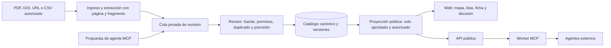

# GoldEye: plan unificado de aplicación territorial y agentes MCP

**Fecha de trabajo:** 25 de noviembre de 2026 (La Paz)

**Fuentes:** informe del proyecto GoldEye para ORO-3.3 del 24 de noviembre de 2026 y el código actual de este repositorio.
**Propósito:** entregar una sola experiencia verificable para personas y agentes, con un catálogo, un proceso de revisión y reglas de publicación compartidos.

> La sección 2 registra el estado de partida anterior a la implementación del MCP mejorado. El estado actual, las pruebas y el despliegue se documentan en [README.md](README.md).

## 1. Producto que vamos a construir

GoldEye responde una pregunta concreta: **«¿Qué se midió aquí, dónde puedo comprobarlo y qué falta investigar?»**. La primera zona es la cuenca del Beni, con el río Kaka como caso de demostración. Una persona entra por un mapa 2D o una lista, filtra estudios y mediciones, abre la fuente y su página, distingue fecha de muestreo de fecha de publicación y guarda una ficha de decisión. Un agente MCP consulta exactamente las mismas fichas públicas, cita su procedencia y propone candidatos o valores para revisión.

La publicación siempre la autoriza una persona. Una propuesta de agente, una extracción de PDF y un registro en borrador no se convierten en evidencia pública por aparecer en el sistema. Un resultado vacío significa «no hay registros bajo estos filtros en el catálogo indexado»; no prueba que no existan estudios o contaminación en el territorio.

### Dos entradas, un catálogo

| Entrada | Qué permite | Límite |
| --- | --- | --- |
| Web para personas | Mapa y lista, ficha verificable, enlace a la fuente, vacíos acotados al catálogo y ficha de decisión compartible. | Solo muestra información publicada y autorizada. |
| MCP para agentes | Buscar, listar vacíos del catálogo, obtener fichas y proponer candidatos o valores con procedencia. | No confirma campos ni publica; las propuestas quedan pendientes. |
| Revisión interna | Ingresar fuentes, comparar duplicados, corregir campos, registrar permisos y aprobar o retirar fichas. | Exige identidad de revisor y deja historial. |

**Prioridad de acceso:** búsqueda, lectura y propuesta gratuitas. Los informes y anexos de pago del prototipo MCP son una opción comercial posterior. Nunca condicionan el acceso a las fuentes, las citas o las fichas públicas.

## 2. Estado inicial y brecha principal

El repositorio actual ya tiene un Worker MCP/REST sin dependencias, siete herramientas, un cliente de ejemplo y 33 pruebas locales. Permite buscar, proponer, generar un informe y exportar un anexo; el cobro por créditos y x402 está preparado como demostración. No hay aplicación web, mapa, base científica persistente, extracción de PDF, bandeja de revisión ni fichas reales aprobadas. El catálogo inicial contiene una ficha en borrador y tres candidatos de ejemplo. El Worker crea ese catálogo de nuevo en cada solicitud y su salida pública incluye esos ejemplos.

La **primera corrección obligatoria** antes de conectar una web o desplegar con datos reales es crear una salida pública que excluya borradores, candidatos no autorizados, ubicaciones restringidas y sugerencias sin firma. Web y MCP consumirán esa misma salida. Las propuestas tendrán su propia entrada y nunca alterarán directamente el catálogo publicado.

## 3. Arquitectura de destino y ruta de migración

**Para la demo:** usar un esquema JSON versionado y un archivo público generado únicamente a partir de fichas aprobadas por una persona. La aprobación puede registrarse en una revisión de cambios con nombre, fecha y fuente. El Worker existente leerá esta proyección pública, en vez de llamar a `catalogoInicial()` para cada consulta. Las propuestas pueden seguir saliendo como archivos para pull request mientras no exista una cola interna. Esto permite una demostración de extremo a extremo sin poner una base de datos nueva en la ruta crítica.

**Para el piloto de 30 días:** pasar el catálogo canónico, las propuestas, la revisión y el historial a FastAPI + PostgreSQL/PostGIS, según el informe. El backend generará la misma proyección pública; la web y el Worker no consultarán tablas privadas. Next.js + TypeScript y MapLibre GL JS + GeoJSON forman la interfaz. La extracción inicial puede usar `pdfplumber` o `pypdfium2`, y siempre guarda página, fragmento y estado de revisión. Los documentos de terceros se enlazan; su PDF solo se almacena o redistribuye con licencia o permiso explícito.

**Contrato común:** definir JSON Schema y OpenAPI para que web, API y MCP usen nombres y reglas iguales. Entidades mínimas: fuente, estudio/proyecto, medición, ubicación y precisión, evidencia por campo, permiso, revisión, propuesta, vacío confirmado y ficha de decisión. Cada ficha distingue fecha de muestreo y publicación; cada dato publicado conserva fuente, página o sección, revisor, versión y estado de permiso. La huella SHA-256 ayuda a identificar versiones del archivo, pero no sustituye la revisión científica.

### Estados y reglas

`candidato → borrador → en_revision → aprobado → publicado → retirado`. Solo `publicado` con permiso vigente aparece en búsqueda, mapa, exportación, caché pública y MCP. «Aprobado» es una decisión interna previa a publicar. Una corrección crea nueva versión; una retirada invalida la proyección y la caché. Las sugerencias de agentes mantienen su identificador, origen y fecha, y nunca cambian un campo firmado sin otra revisión.

## 4. Prioridades y dificultad

La **prioridad** marca cuándo bloquea el siguiente paso; la **dificultad** estima esfuerzo técnico y de coordinación. Las horas son rangos por persona, no promesas de entrega.

| Dificultad | Regla orientativa |
| --- | --- |
| Baja | 1–4 h; cambio local o preparación de evidencia. |
| Media | 0,5–2 días; integra dos piezas o requiere revisión de contenido. |
| Alta | 2–5 días o más; involucra datos, seguridad, varias capas o validación externa. |

### P0 — recorrido verificable para ORO-3.3

Se trabaja en este orden. Las tareas de contenido científico y permisos pueden avanzar en paralelo con la interfaz y el adaptador MCP.

| ID | Tarea | Dificultad | Depende de | Terminado cuando... |
| --- | --- | --- | --- | --- |
| P0-01 | Fijar la pregunta del Kaka, el territorio piloto, los tipos de muestra y la lista de fuentes candidatas. Confirmar requisitos y fechas de la convocatoria con el equipo. | Baja | — | Hay un guion de un minuto y responsables por fuente. |
| P0-02 | Definir el esquema común, estados, permisos, precisión geográfica y campos obligatorios. | Media | P0-01 | Dos fuentes distintas caben en el mismo esquema sin inventar valores faltantes. |
| P0-03 | Curar **cinco estudios reales** para el primer corte: autor, enlace, página, licencia, fecha de muestra/publicación, método y límites. Separar estudio, proyecto y medición. | Alta | P0-02 | Cinco fichas tienen respaldo comprobado y firma de revisor; las que falten se declaran pendientes. |
| P0-04 | Construir una extracción de un PDF autorizado que sugiera campos con página y fragmento. | Alta | P0-02 | Se corrige al menos un campo comparándolo con el PDF y se registra el acierto de la extracción. |
| P0-05 | Registrar aprobación humana y generar una proyección pública filtrada. Empezar con datos ficticios para no esperar a que termine la curación. | Alta | P0-02 | Ningún borrador, sugerencia o ubicación restringida sale en JSON, web, exportación o MCP. |
| P0-06 | Crear una web móvil con mapa 2D del Beni/Kaka, lista equivalente y filtros por lugar, fecha y matriz; especie cuando la fuente la respalde. | Alta | P0-02, P0-05 | La misma consulta se resuelve en celular mediante mapa o lista. |
| P0-07 | Crear ficha verificable con hallazgo, estudio original y «qué falta saber». Enlazar página o sección, autor, método, dos fechas y revisor. | Media | P0-05 | Una persona puede abrir la referencia correcta desde la ficha y copiar su cita. |
| P0-08 | Crear ficha de decisión compartible: fuentes encontradas, dato pendiente, motivo y posible contacto institucional. | Media | P0-07 | La ficha conserva el alcance de la consulta y se puede compartir o exportar sin datos privados. |
| P0-09 | Adaptar `buscar_estudios`, `obtener_ficha` y `listar_vacios` para leer la proyección pública; conservar la compatibilidad MCP actual. | Media | P0-05 | Web, API y MCP devuelven el mismo conjunto aprobado bajo filtros equivalentes. |
| P0-10 | Mantener `proponer_candidato` y `sugerir_valor` como propuestas trazables; entregar archivo de PR mientras no exista cola privada. | Media | P0-02 | La propuesta incluye fuente, motivo, agente y página cuando aplique, y no aparece como publicada. |
| P0-11 | Probar permisos, ausencia de resultados, duplicados y retirada con datos ficticios. | Media | P0-05, P0-09 | Un test demuestra que los registros privados no salen por ninguna ruta pública; otro muestra que una coincidencia no fusiona fichas sola. |
| P0-12 | Observar dos consultas equivalentes con usuarios potenciales; registrar tiempo, acierto, página encontrada y siguiente decisión. | Media | P0-06, P0-07 | Hay notas de prueba, una mejora aplicada y resultados presentados como casos observados. |
| P0-13 | Preparar demo, deck y respaldo local o video. Mostrar fuente real, revisión de un campo, consulta y propuesta de agente. | Baja | P0-03, P0-04, P0-06, P0-07, P0-09, P0-11 | El recorrido funciona sin depender de una llamada externa durante la presentación. |

**Ruta crítica técnica:** P0-01 → P0-02 → P0-05 → P0-06/P0-09 → P0-11 → P0-13. **Ruta crítica de contenido:** P0-01 → P0-02 → P0-03/P0-04 → P0-07 → P0-12. Ambas avanzan en paralelo. El volumen de fichas y su revisión humana son el mayor riesgo de calendario; no se sustituyen por ejemplos presentados como evidencia real.

### P1 — piloto de 30 días

| ID | Tarea | Dificultad | Depende de | Terminado cuando... |
| --- | --- | --- | --- | --- |
| P1-01 | Migrar catálogo, propuestas, revisiones y versiones a FastAPI + PostgreSQL/PostGIS. | Alta | P0-02, P0-05 | La API reproduce la proyección pública y conserva el historial privado. |
| P1-02 | Crear bandeja de revisión con roles, corrección de campos, permisos y retirada. | Alta | P1-01 | Solo un revisor autorizado aprueba o retira y cada cambio queda atribuible. |
| P1-03 | Añadir carga controlada de PDF/CSV, hash, detección de duplicados y vínculo con documentos primarios. | Alta | P1-01, P0-04 | Una segunda colección entra sin duplicar automáticamente una medición. |
| P1-04 | Conectar propuestas MCP autenticadas a la cola privada con límites de uso y control de duplicados. | Media | P1-01, P0-10 | Un agente ve acuse de recibo; la propuesta sigue pendiente hasta revisión humana. |
| P1-05 | Acordar con un posible custodio permisos, ritmo de actualización, correcciones y retiro. | Media | P0-12 | Hay responsable propuesto y un flujo de mantenimiento documentado. |
| P1-06 | Medir costo real de curación, tiempo de consulta, fichas completas, aportes externos y vacíos confirmados. | Media | P0-12, P1-02 | Informe de 30 días con denominadores, fechas, supuestos y decisiones. |

### P2 — interoperabilidad y sostenibilidad, 60–90 días

| ID | Tarea | Dificultad | Depende de | Terminado cuando... |
| --- | --- | --- | --- | --- |
| P2-01 | Publicar API de lectura documentada y validar un segundo territorio o colección autorizada. | Alta | P1-01, P1-03 | Otro equipo importa datos con el mismo contrato, atribución y permisos. |
| P2-02 | Añadir PWA, consulta sin conexión de fichas públicas seleccionadas y recorrido visual 3D opcional. | Alta | P0-06, P1-02 | Vista 2D/lista resuelve la misma pregunta y la caché respeta retiradas y permisos. |
| P2-03 | Validar MCP con un cliente externo, documentación de conexión, observabilidad y límites. | Media | P1-04, P2-01 | Un cliente tercero lee una ficha publicada y entrega una propuesta que entra a revisión. |
| P2-04 | Evaluar informes y anexos de pago con usuarios; revisar factura, cobro idempotente, saldos y x402 en red de prueba antes de activarlos. | Alta | P2-03, P1-06 | Hay demanda comprobada, reglas de cobro probadas y ninguna lectura básica está detrás de pago. |

## 5. Entregas y decisiones de alcance

| Momento | Entrega verificable | Regla si falta evidencia |
| --- | --- | --- |
| 25 nov | Contrato de datos, fuentes asignadas, caso Kaka, lista de permisos y primera prueba del filtro público con datos ficticios. | Marcar cada fuente como pendiente hasta revisar documento y página. |
| 26 nov, antes de las 23:59 de La Paz según el informe | Deck, respaldo y demo con búsqueda → fuente → corrección → publicación autorizada → consulta MCP. Objetivo interno: cinco fichas revisadas. | Si no se alcanzan cinco, mostrar el número real y el bloqueo. No publicar borradores para completar la cifra. |
| 27–28 nov | Demostración técnica y, si corresponde, final: prueba con usuarios, límites, costo y posible custodio. | Separar hechos observados, datos de ejemplo y funciones futuras. |
| 30 días | Piloto con revisión persistente, aportes autorizados y costo observado. | Mantener fuera del catálogo público todo dato sin permiso o firma. |
| 60–90 días | Segunda colección, API/MCP validados con terceros y decisión sobre cobro. | Activar pagos solo después de pruebas y revisión operativa. |

El informe propone seis encargos internos, pero señala que la convocatoria puede limitar integrantes inscritos. Para trabajar con cinco responsables, combinar **producto/pitch** con **validación/alianzas**; conservar aparte **curación científica**, **extracción/calidad**, **backend/datos/MCP** y **frontend/mapa**. Si el equipo real es menor, cada tarea mantiene un dueño y se reduce el alcance antes de repartir trabajo sin revisión.

## 6. Criterios de cierre del producto unificado

1. Una consulta sobre el Kaka llega desde mapa **y** lista hasta una fuente y su página; fecha de muestra y publicación son distintas cuando corresponde.
2. Una ficha publicada tiene procedencia, permiso, precisión autorizada, revisor y versión. Las ausencias se muestran como desconocidas.
3. Web, API, JSON público, exportación y MCP muestran exactamente las mismas fichas autorizadas. Borradores, datos sensibles y propuestas nunca aparecen en esas salidas.
4. Un agente puede proponer un estudio y un valor con evidencia; solo la persona revisora puede aprobarlos y publicarlos.
5. Un vacío se describe como falta de registros en el catálogo bajo un filtro y se confirma con una persona antes de presentarlo como prioridad de investigación.
6. La demo funciona en celular, tiene respaldo local y distingue claramente lo implementado de lo planificado.
7. El piloto registra tiempo de búsqueda, acierto, costo de revisión y correcciones con fechas y responsables. Los servicios de pago permanecen opcionales hasta validar demanda y operación.

**Primera acción de implementación recomendada:** P0-01 y P0-02, seguidas inmediatamente por P0-05. Sin el contrato de datos y el filtro de publicación, conectar el mapa y MCP al catálogo actual multiplicaría el riesgo de mostrar borradores como evidencia pública.
